

  

<strong>Thoughtful engineering. Connected systems. Meaningful progress.</strong>

  <a href="#01--about-me">About</a> &nbsp; · &nbsp;
  <a href="#02--the-connected-toolkit">Toolkit</a> &nbsp; · &nbsp;
  <a href="#04--selected-project-showcases">Projects</a> &nbsp; · &nbsp;
  <a href="#05--the-public-github-record">Activity</a> &nbsp; · &nbsp;
  <a href="#07--lets-connect">Connect</a>

## 01 — About Me

I’m **Salma Adnan**, a Computer Science student at **Albukhary International University** and **Founder & Director of Flunex Institute**. I’m interested in the full journey from a useful idea to a thoughtful interface, a connected system, and a practical outcome.

My work and learning bring together **full-stack development, educational technology, and project coordination**. I care about clear requirements, understandable systems, and digital products that serve the people using them.

<table>
<tr>
<td width="50%" valign="top">
<h3>Engineering perspective</h3>

Practical web applications, backend-connected interfaces, and meaningful digital products.

<strong>INTERFACE → APPLICATION → DATA</strong>

</td>
<td width="50%" valign="top">
<h3>Founder’s perspective</h3>

Leading educational initiatives and coordinating the academic and operational work behind Flunex Institute.

<strong>PEOPLE → SYSTEMS → PURPOSE</strong>

</td>
</tr>
</table>

> **Building digital solutions with real impact.**  
> Technical curiosity, thoughtful collaboration, and a focus on useful outcomes.

[Flunex Institute](https://flunexinstitute.com) &nbsp; · &nbsp; [Email](mailto:Salma2004adnan@gmail.com) &nbsp; · &nbsp; [GitHub](https://github.com/salma3dnan)

## 02 — The Connected Toolkit

A grouped view of my technical toolkit, from the experience people see to the systems that support it.

<table>
<tr>
<td width="50%" valign="top">
<h3>Frontend</h3>

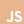

HTML5 · CSS3 · Tailwind CSS · JavaScript · TypeScript · React · Next.js

</td>
<td width="50%" valign="top">
<h3>Backend</h3>

PHP · Laravel · Node.js · Express.js · NestJS

</td>
</tr>
<tr>
<td width="50%" valign="top">
<h3>Databases</h3>

MySQL · PostgreSQL · MongoDB · Redis

</td>
<td width="50%" valign="top">
<h3>Mobile</h3>

Flutter · REST API Integration

</td>
</tr>
<tr>
<td width="50%" valign="top">
<h3>DevOps</h3>

Docker

</td>
<td width="50%" valign="top">
<h3>Deployment</h3>

Vercel

</td>
</tr>
</table>

Authentic technology marks from Simple Icons, presented in a consistent copper palette. These are toolkit categories, not proficiency scores.

## 03 — Engineering Focus

<table>
<tr>
<td width="50%" valign="top">

<h3>Web & Application Development</h3>

Thoughtful interfaces and practical application workflows, shaped around real user needs.

<strong>EXPERIENCE / FUNCTION / CLARITY</strong>

</td>
<td width="50%" valign="top">

<h3>Educational Technology</h3>

Learning environments and academic workflows informed by the everyday realities of institute operations.

<strong>LEARNING / ACCESS / OPERATIONS</strong>

</td>
</tr>
<tr>
<td width="50%" valign="top">

<h3>Systems Integration</h3>

Connecting interfaces, backend APIs, and application data into coherent digital experiences.

<strong>INTERFACES / APIs / DATA</strong>

</td>
<td width="50%" valign="top">

<h3>Project & Product Coordination</h3>

Connecting requirements, priorities, people, and execution while keeping useful outcomes in view.

<strong>PLANNING / COMMUNICATION / DELIVERY</strong>

</td>
</tr>
</table>

## 04 — Selected Project Showcases

A curated view of seven project categories. **Verified institute leadership is distinguished from concept showcases.** The diagrams are conceptual system maps, not screenshots or evidence of completed implementations.

<table>
<tr>
<td width="50%" valign="top">

<strong>01 / EDUCATIONAL TECHNOLOGY</strong>

<h3>Flunex Institute — Educational & Management Ecosystem</h3>
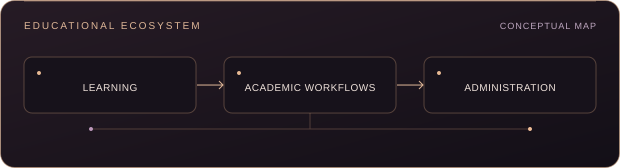

An educational ecosystem covering online learning, student and staff management, examinations, grading, certificates, and institutional administration.

<strong>Verified:</strong> Founder & Director; educational and operational leadership. Individual development contributions and the implementation status of each module are not asserted.

<a href="https://flunexinstitute.com">Visit Flunex Institute ↗</a>

</td>
<td width="50%" valign="top">

<strong>02 / COMMERCE & RELATIONSHIPS</strong>

<h3>E-Commerce & CRM System</h3>
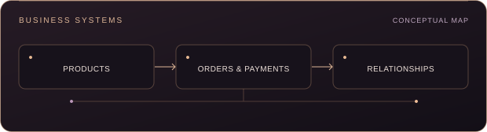

An integrated business solution concept for online sales, product management, customer relationships, orders, and payments.

<strong>CONCEPT SHOWCASE · DELIVERY UNVERIFIED</strong>

</td>
</tr>
<tr>
<td width="50%" valign="top">

<strong>03 / PEOPLE & OPERATIONS</strong>

<h3>HRMS & Appointment Management System</h3>
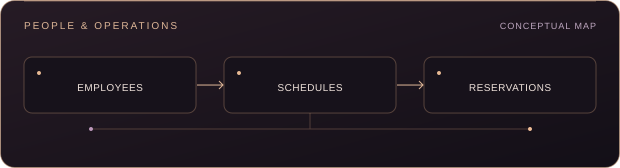

A unified system concept for employee management, attendance, payroll, scheduling, and reservations.

<strong>CONCEPT SHOWCASE · DELIVERY UNVERIFIED</strong>

</td>
<td width="50%" valign="top">

<strong>04 / PLATFORM ENGINEERING</strong>

<h3>Subscription-Based SaaS Platform</h3>
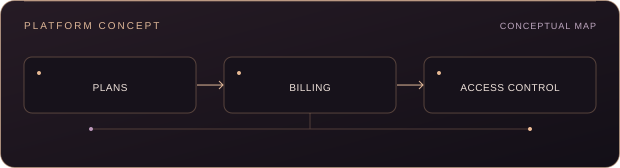

A platform concept bringing together subscription plans, billing, user roles, and access control.

<strong>CONCEPT SHOWCASE · DELIVERY UNVERIFIED</strong>

</td>
</tr>
<tr>
<td width="50%" valign="top">

<strong>05 / MOBILE EXPERIENCES</strong>

<h3>Flutter Mobile Application</h3>
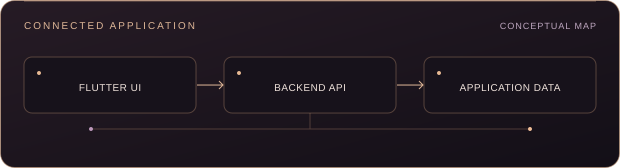

A cross-platform mobile application concept connected to backend services through APIs.

<strong>CONCEPT SHOWCASE · DELIVERY UNVERIFIED</strong>

</td>
<td width="50%" valign="top">

<strong>06 / DATA & INSIGHT</strong>

<h3>Analytics & Reporting Platform</h3>
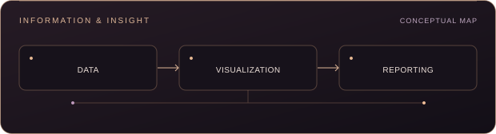

A dashboard concept for data visualization, performance tracking, and business reporting.

<strong>CONCEPT SHOWCASE · DELIVERY UNVERIFIED</strong>

</td>
</tr>
<tr>
<td colspan="2" valign="top">

<strong>07 / AI & CONNECTED INTELLIGENCE</strong>

<h3>AI-Powered Application</h3>
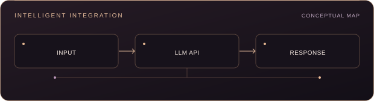

An exploratory application concept integrating large language models through APIs.

<strong>EXPLORATORY CONCEPT · DELIVERY UNVERIFIED</strong>

</td>
</tr>
</table>

No unverified repository or demo URLs are attached to these showcases. A showcase does not imply a completed deployment, client commission, or public source release.

## 05 — The Public GitHub Record

A measured view of public activity, with a copper palette and no third-party widget dependency.

<a href="https://github.com/salma3dnan?tab=repositories">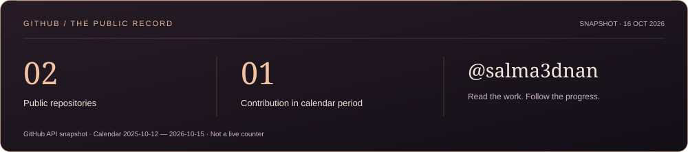</a>

<a href="https://github.com/salma3dnan?tab=overview">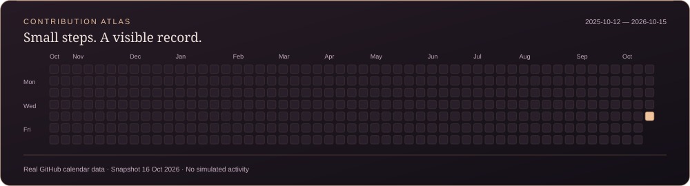</a>

These are dated snapshots from GitHub’s API, not live counters. The calendar reflects the activity GitHub returned for the stated period. Source-language analytics are omitted because the public repositories currently report no language data.

[Explore public repositories](https://github.com/salma3dnan?tab=repositories) &nbsp; · &nbsp; [View current contribution activity](https://github.com/salma3dnan?tab=overview)

## 06 — Currently Exploring

**A deliberate learning roadmap.** These are areas I’m developing, not claims of mastered expertise.

| Direction | What I’m exploring |
| :--- | :--- |
| **Cloud & Infrastructure** | Deployment workflows, containers, hosting, and the foundations of reliable services |
| **Email & System Integration** | Transactional email, domain authentication, and connected service workflows |
| **API Engineering & Real-Time Systems** | API contracts, webhooks, event-driven communication, and live updates |
| **Testing & Security** | Meaningful automated checks, input validation, and secure defaults |
| **AI & Automation** | LLM API integrations and repeatable, useful workflows |
| **Product & Technical Planning** | Clear requirements, architecture decisions, and practical delivery planning |

## 07 — Let’s Connect

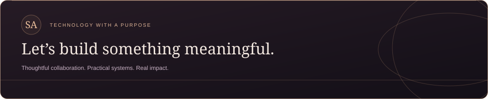

**Technology is most valuable when it solves real problems.** I welcome thoughtful conversations about web applications, educational technology, and meaningful digital products.

<a href="mailto:Salma2004adnan@gmail.com">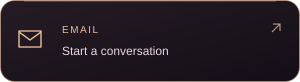</a>
<a href="https://flunexinstitute.com">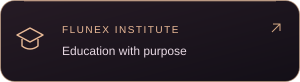</a>
<a href="https://github.com/salma3dnan">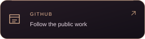</a>

<a href="mailto:Salma2004adnan@gmail.com">Salma2004adnan@gmail.com</a> &nbsp; · &nbsp; <a href="https://flunexinstitute.com">Flunex Institute</a> &nbsp; · &nbsp; <a href="https://github.com/salma3dnan">@salma3dnan</a>

SALMA ADNAN &nbsp; / &nbsp; ENGINEERING · EDUCATION · IMPACT

