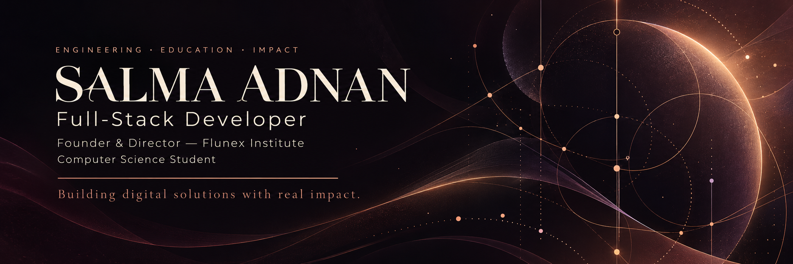

I’m **Salma Adnan**, a Computer Science student at **Albukhary International University** and **Founder & Director of Flunex Institute**. I build practical web applications and explore how educational systems, connected platforms, and thoughtful digital products can serve real needs.

[Flunex Institute](https://flunexinstitute.com) &nbsp; · &nbsp; [Email](mailto:Salma2004adnan@gmail.com) &nbsp; · &nbsp; [GitHub](https://github.com/salma3dnan)

## Core Tech Stack

| Area | Technologies |
| :--- | :--- |
| **Frontend** | HTML5 · CSS3 · Tailwind CSS · JavaScript · TypeScript · React · Next.js |
| **Backend** | PHP · Laravel · Node.js · Express.js · NestJS |
| **Databases** | MySQL · PostgreSQL · MongoDB · Redis |
| **Mobile** | Flutter · REST API Integration |
| **DevOps** | Docker |
| **Deployment** | Vercel |

## Engineering Focus

**Web & Application Development**  
Practical interfaces and application workflows shaped around the people using them.

**Educational Technology**  
Learning platforms and academic workflows informed by institute operations.

**Systems Integration**  
Connecting interfaces, APIs, and data into coherent digital experiences.

**Project & Product Coordination**  
Turning requirements into clear priorities, coordinated work, and useful outcomes.

## Featured Projects

### [Salma Adnan Portfolio](https://github.com/salma3dnan/salma-adnan-portfolio)

A personal portfolio with responsive layouts, project case studies, accessible motion fallbacks, and a server-side contact integration.

**Built with** Next.js · React · TypeScript · Tailwind CSS · Resend

[Explore the source](https://github.com/salma3dnan/salma-adnan-portfolio)

## Selected GitHub Activity

Follow my public work through [repositories and contribution activity](https://github.com/salma3dnan?tab=overview).

## Currently Exploring

Learning directions I’m developing alongside practical projects:

| Direction | Areas of exploration |
| :--- | :--- |
| **Cloud & Infrastructure** | Deployment workflows and containerized services |
| **Email & System Integration** | Transactional email and connected service workflows |
| **API Engineering & Real-Time Systems** | API design, event-driven communication, and live updates |
| **Testing & Security** | Automated checks, input validation, and secure defaults |
| **AI & Automation** | Useful integrations and repeatable workflows |
| **Product & Technical Planning** | Requirements, technical decisions, and delivery planning |

---

### Technology is most valuable when it solves real problems.

I welcome thoughtful conversations about web applications, educational technology, and meaningful digital products.

[Start a conversation](mailto:Salma2004adnan@gmail.com) &nbsp; · &nbsp; [Discover Flunex Institute](https://flunexinstitute.com)
